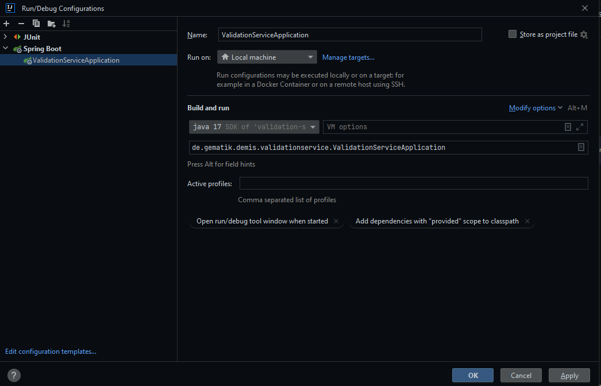

<div style="text-align:right"> <br/> </div> <br/>

# Validation-Service

[](https://sonar.prod.ccs.gematik.solutions/dashboard?id=de.gematik.demis%3Avalidation-service)
[](https://sonar.prod.ccs.gematik.solutions/dashboard?id=de.gematik.demis%3Avalidation-service)
[](https://sonar.prod.ccs.gematik.solutions/dashboard?id=de.gematik.demis%3Avalidation-service)
[](https://sonar.prod.ccs.gematik.solutions/dashboard?id=de.gematik.demis%3Avalidation-service)
[](https://sonar.prod.ccs.gematik.solutions/dashboard?id=de.gematik.demis%3Avalidation-service)
[](https://sonar.prod.ccs.gematik.solutions/dashboard?id=de.gematik.demis%3Avalidation-service)

<details>
  <summary>Table of Contents</summary>
  <ol>
    <li>
      <a href="#about-the-project">About The Project</a>
       <ul>
        <li><a href="#release-notes">Release Notes</a></li>
      </ul>
	</li>
    <li>
      <a href="#getting-started">Getting Started</a>
      <ul>
        <li><a href="#docker-build">Docker build</a></li>
        <li><a href="#docker-run">Docker run</a></li>
        <li><a href="#intellij-cmd">Intellij/CMD</a></li>
        <li><a href="#kubernetes">Kubernetes</a></li>
        <li><a href="#endpoints">Endpoints</a></li>
      </ul>
    </li>
    <li><a href="#security-policy">Security Policy</a></li>
    <li><a href="#contributing">Contributing</a></li>
    <li><a href="#license">License</a></li>
    <li><a href="#contact">Contact</a></li>
  </ol>
</details>

## About The Project

The Validation Service is responsible for validating FHIR resources according to the HL7 FHIR specification, based on
predefined FHIR profiles, provided from RKI (Robert Koch Institute). These profiles are loaded from the file system
during the service startup phase. Please note that the profiles are not part of this repository. In a Kubernetes
environment, the FHIR profiles are mounted to the service's file system from a dedicated OCI container image.

This service is a Spring Boot-based application that processes HTTP requests and leverages appropriate HAPI FHIR library
methods to perform the following tasks:

- Message Parsing
- Validation
- Response Serialization

### Release Notes

See [ReleaseNotes](ReleaseNotes.md) for all information regarding the (newest) releases.

## Getting Started

The application requires the DEMIS FHIR Profiles. This image is maintained in DockerHub:
[demis-profile-snapshots](https://hub.docker.com/repository/docker/gematik1/demis-fhir-profile-snapshots/general).

The profiles are require to execute the integration profile tests included in this repository. With -PskipProfileTests
you can skip these tests if you don't have profiles locally.
At runtime execution the profile files must be available in a folder and this folder must be specified through the
environment variable `FHIR_PROFILES_BASEPATH`.

### Installation

```sh
mvn clean verify
```

The Project can be built with the following command:

```sh
mvn -e clean install -DskipTests=true
```

build with docker image:

```docker
docker build -t validation-service:latest .
```

The Docker Image associated to the service can be built alternatively with the extra profile `docker`:

```docker
mvn -e clean install -Pdocker
```

or if you don't have the profiles

```docker
mvn -e clean install -PskipProfileTests -Pdocker
```

The application can be started as Docker container with the following commands assuming that the profile snapshots are
located in directory /profiles/5.2.0/Fhir

```shell
docker run --rm --name validation-service \
    -v $(pwd)/profiles:/profiles \
    -p 8080:8080 \
    -e FHIR_PROFILES_BASEPATH=/profiles \
    -e PACKAGE_VERSIONS=5.2.0 \
    validation-service:latest
```

## Kubernetes

## Local

aus IntelliJ als SpringBoot Application starten



## Intellij/CMD

Start the spring boot server with: `mvn clean spring-boot:run`
Check the server with: `curl -v localhost:8080/actuator/health`

aus IntelliJ als SpringBoot Application starten

## VM

## Properties

Configuration values are bound to typed `@ConfigurationProperties` classes and injected as those classes; individual
properties should not be injected into Spring services. The environment-variable column shows the deployment-facing
name configured in `application.properties`.

| Spring property | Default | Environment variable | Description |
|---|---|---|---|
| `demis.validation-service.profiles.basepath` | empty | `FHIR_PROFILES_BASEPATH` | Base directory containing profile-version directories. Required at startup. |
| `demis.validation-service.profiles.fhirpath` | `Fhir` | — | Path within a profile-version directory containing FHIR resources. |
| `demis.validation-service.profiles.versions` | empty | `PACKAGE_VERSIONS` | Comma-separated profile versions to load; must match directories under the base path. Required at startup. |
| `demis.validation-service.locale` | `en_US` | — | Locale used for HAPI FHIR diagnostics. |
| `demis.validation-service.minSeverityOutcome` | `warning` | — | Lowest severity retained in the outcome: `information`, `warning`, `error`, or `fatal`. |
| `demis.validation-service.unexpected-extension-severity` | `warning` | — | Severity assigned to unexpected extensions. |
| `demis.validation-service.additional-strict-coding-validator-enabled` | `false` | `CONFIG_OPTION_ADDITIONAL_STRICT_CODING_VALIDATOR_ENABLED` | Enables the additional strict ValueSet membership validator. |
| `demis.validation-service.common-code-system-terminology-enabled` | `false` | `CONFIG_OPTION_COMMON_CODE_SYSTEM_TERMINOLOGY_ENABLED` | Enables HAPI's common CodeSystem terminology support. |
| `demis.validation-service.custom-regex-validator-enabled` | `false` | `CONFIG_OPTION_CUSTOM_REGEX_VALIDATOR_ENABLED` | Enables custom QuestionnaireResponse regex validation. |
| `demis.validation-service.custom-quantity-validator-enabled` | `false` | `CONFIG_OPTION_CUSTOM_QUANTITY_VALIDATOR_ENABLED` | Enables custom QuestionnaireResponse quantity validation. |
| `demis.validation-service.resource-references.trusted-external-domains` | empty | `CONFIG_OPTION_TRUSTED_EXTERNAL_REFERENCES_DOMAINS` | Comma-separated domains accepted as trusted external Bundle references. |
| `demis.validation-service.terminology-server.enabled` | `false` | `FEATURE_FLAG_TERMINOLOGY_SERVER` | Spring bean-condition switch for the terminology provider. |
| `demis.validation-service.terminology-server.url` | empty | `CONFIG_OPTION_TERMINOLOGY_SERVER_URL` | Terminology-server URL property. |

These settings are grouped in `ValidationConfigProperties` and
`ResourceReferencesBundleValidationConfigProperties`. The terminology-server switch is currently used with Spring's
`@ConditionalOnProperty`; the URL is declared in `application.properties` but is not part of those configuration
classes. New settings should follow the typed-configuration pattern rather than extending this exception.

## Feature Flags


Feature flags are bound to the `FeatureFlags` class. These switches use the `feature.flag.*` Spring-property namespace:

| Spring property | Environment variable | Default | Description |
|---|---|---:|---|
| `feature.flag.format-validation-enabled` | `FEATURE_FLAG_FORMAT_VALIDATION_ENABLED` | `true` | Enables the pre-validation check that the request body is well-formed JSON or XML. |
| `feature.flag.filtered-errors-as-warnings-disabled` | `FEATURE_FLAG_FILTERED_ERRORS_AS_WARNINGS_DISABLED` | `false` | Disables downgrading selected validation errors to warnings when enabled. |
| `feature.flag.codesystem-version-verification-enabled` | `FEATURE_FLAG_CODESYSTEM_VERSION_VERIFICATION_ENABLED` | `false` | Enables CodeSystem version verification. |
| `feature.flag.vs-hapi-qr-qmin-verification-enabled` | `FEATURE_FLAG_VS_HAPI_QR_QMIN_VERIFICATION_ENABLED` | `false` | Enables HAPI's lower-bound verification for QuestionnaireResponse quantities. |
| `feature.flag.address-country-errors-as-warnings-disabled` | `FEATURE_FLAG_ADDRESS_COUNTRY_ERRORS_AS_WARNINGS_DISABLED` | `false` | When `true`, disables downgrading selected country-code errors to warnings. |
| `feature.flag.address-state-errors-as-warnings-disabled` | `FEATURE_FLAG_ADDRESS_STATE_ERRORS_AS_WARNINGS_DISABLED` | `false` | When `true`, disables downgrading selected state-code errors to warnings. |
| `feature.flag.address-zip-errors-as-warnings-disabled` | `FEATURE_FLAG_ADDRESS_ZIP_ERRORS_AS_WARNINGS_DISABLED` | `false` | When `true`, disables downgrading selected postal-code errors to warnings. |
| `feature.flag.vs-reference-validation` | `FEATURE_FLAG_VS_REFERENCE_VALIDATION` | `false` | Enables validation of Bundle references, including resolution of references to resources in the same Bundle. |
| `feature.flag.abstract-profile-validation` | `FEATURE_FLAG_ABSTRACT_PROFILE_VALIDATION` | `false` | Enables checks that abstract profiles are not used directly on resource instances. |
| `feature.flag.reference-profile-validation` | `FEATURE_FLAG_REFERENCE_PROFILE_VALIDATION` | `false` | Enables validation of referenced resources against slice-specific target profile constraints. |
| `feature.flag.fhir-package-postprocessing` | `FEATURE_FLAG_FHIR_PACKAGE_POSTPROCESSING` | `false` | Enables post-processing of profile-package resources, including CodeSystem consolidation. |
| `feature.flag.hl7-issue-2876-fixed` | `FEATURE_FLAG_HL7_ISSUE_2876_FIXED` | `false` | Set to `true` only after HL7 Core issue [2876](https://github.com/hapifhir/org.hl7.fhir.core/issues/2876) is fixed. While `false`, loading Observation profiles relaxes `Observation.value[x]:valueString.value` from `min=1` to `min=0` in snapshots and differentials, in memory only. This intentionally allows extension-only string values. |

## Usage

Start the spring boot server with: `mvn clean spring-boot:run`
Check the server with: `curl -v localhost:8080/actuator/health`

### Endpoints


| Endpoint                     | Description                                                                                |
| ---------------------------- | ------------------------------------------------------------------------------------------ |
| `/status`                    | GET endpoint for status notifications. Currently minimally implemented.                    |
| `/$validate`                 | POST endpoint for validating messages. Returns validation results from the HAPI Validator. |
| `/actuator/health/`          | Standard endpoint from Actuator.                                                           |
| `/actuator/health/liveness`  | Standard endpoint from Actuator.                                                           |
| `/actuator/health/readiness` | Standard endpoint from Actuator.                                                           |

## Security Policy

If you want to see the security policy, please check our [SECURITY.md](.github/SECURITY.md).

## Contributing

If you want to contribute, please check our [CONTRIBUTING.md](.github/CONTRIBUTING.md).

## License

Copyright 2022-2025 gematik GmbH

EUROPEAN UNION PUBLIC LICENCE v. 1.2

EUPL © the European Union 2007, 2016

See the [LICENSE](./LICENSE.md) for the specific language governing permissions and limitations under the License

## Additional Notes and Disclaimer from gematik GmbH

1. Copyright notice: Each published work result is accompanied by an explicit statement of the license conditions for use. These are regularly typical conditions in connection with open source or free software. Programs described/provided/linked here are free software, unless otherwise stated.
2. Permission notice: Permission is hereby granted, free of charge, to any person obtaining a copy of this software and associated documentation files (the "Software"), to deal in the Software without restriction, including without limitation the rights to use, copy, modify, merge, publish, distribute, sublicense, and/or sell copies of the Software, and to permit persons to whom the Software is furnished to do so, subject to the following conditions:
   1. The copyright notice (Item 1) and the permission notice (Item 2) shall be included in all copies or substantial portions of the Software.
   2. The software is provided "as is" without warranty of any kind, either express or implied, including, but not limited to, the warranties of fitness for a particular purpose, merchantability, and/or non-infringement. The authors or copyright holders shall not be liable in any manner whatsoever for any damages or other claims arising from, out of or in connection with the software or the use or other dealings with the software, whether in an action of contract, tort, or otherwise.
   3. We take open source license compliance very seriously. We are always striving to achieve compliance at all times and to improve our processes. If you find any issues or have any suggestions or comments, or if you see any other ways in which we can improve, please reach out to: ospo@gematik.de
3. Please note: Parts of this code may have been generated using AI-supported technology. Please take this into account, especially when troubleshooting, for security analyses and possible adjustments.

## Contact

E-Mail to [DEMIS Entwicklung](mailto:demis-entwicklung@gematik.de?subject=[GitHub]%20Validation-Service)
